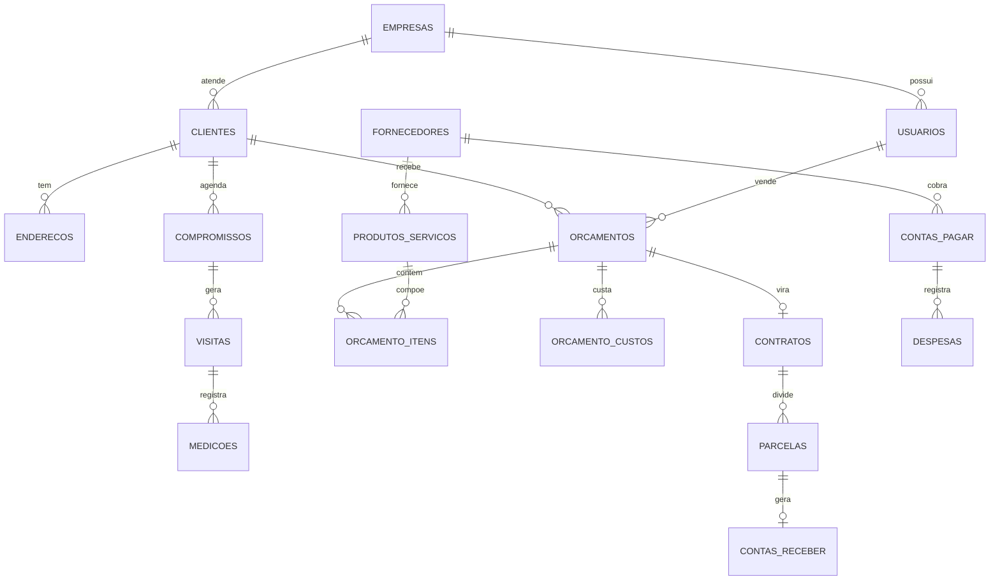

# Vitrix — Banco de dados de um sistema de gestão para vidraçarias

Modelagem e implementação em **PostgreSQL** do back-end do Vitrix, um dashboard de gestão para empresas de vidros e esquadrias. O banco cobre o ciclo completo do negócio: cliente → visita técnica e medição → orçamento → contrato → parcelas e financeiro.

O projeto roda no **Supabase** (Postgres gerenciado com autenticação e API automática), mas os scripts funcionam em qualquer PostgreSQL 15+.

## Destaques técnicos

- **21 tabelas normalizadas** com chaves estrangeiras e regras de exclusão pensadas caso a caso (`CASCADE` para dados dependentes, `SET NULL` para preservar histórico).
- **10 tipos `ENUM`** para status e categorias, garantindo integridade sem tabelas auxiliares.
- **Colunas geradas**: a área em m² é calculada pelo próprio banco a partir de largura × altura × quantidade.
- **Triggers em PL/pgSQL**: ao inserir, alterar ou remover um item ou custo, o orçamento recalcula sozinho subtotal, desconto, valor final e margem de lucro.
- **Views** que alimentam o dashboard: indicadores do mês, quadro Kanban de orçamentos e agenda de compromissos.
- **Índices compostos** para as consultas mais frequentes (filtros por empresa, status e vencimento).
- **Row Level Security** ativado em todas as tabelas.
- **Arquitetura multiempresa**: todo registro pertence a uma `empresa_id`.

## Modelo de dados (principais relações)



Tabelas de apoio: `lancamentos_financeiros` (livro-caixa), `anexos` (arquivos ligados a qualquer registro), `notificacoes` e `logs_atividades` (auditoria em JSONB).

## Arquivos

| Arquivo | Conteúdo |
|---|---|
| `schema.sql` | Tipos, tabelas, índices, views, funções, triggers e RLS |
| `seed.sql` | Dados **fictícios** de demonstração (maio a outubro de 2026) |
| `consultas.sql` | 8 consultas analíticas respondendo perguntas de negócio |

## Consultas analíticas

O arquivo `consultas.sql` responde perguntas reais de um dono de vidraçaria:

1. Faturamento mensal e ticket médio
2. Taxa de conversão de orçamentos por vendedor
3. Margem bruta por categoria de produto
4. Qual canal de aquisição (Instagram, Google, indicação...) traz clientes que fecham
5. Fluxo de caixa mensal com saldo acumulado (`SUM() OVER`)
6. Contas a receber em aberto por prazo de vencimento
7. Ranking de produtos por receita (`RANK()`)
8. Funil de vendas por etapa

Exemplo de resultado (consulta 2, com os dados de demonstração):

| vendedor | orçamentos | convertidos | conversão | valor vendido |
|---|---|---|---|---|
| Carla Melo | 7 | 3 | 42,9% | R$ 39.455,20 |
| Bruno Lima | 7 | 5 | 71,4% | R$ 26.869,60 |

## Como rodar

**No Supabase:** abra o *SQL Editor* do projeto e execute `schema.sql`, depois `seed.sql`, depois as consultas de `consultas.sql`.

**Em um PostgreSQL local:** a tabela `usuarios` referencia `auth.users` e as policies usam o papel `authenticated`, que existem só no Supabase. Crie esses objetos antes:

```sql
create role authenticated;
create schema auth;
create table auth.users (id uuid primary key);
```

Depois:

```bash
psql -d vitrix -f schema.sql
psql -d vitrix -f seed.sql
psql -d vitrix -f consultas.sql
```

## Próximos passos

- Restringir as policies de RLS para que cada usuário veja apenas os dados da própria `empresa_id`.
- Gerar automaticamente as parcelas e contas a receber quando um contrato for assinado.
- Criar uma view de inadimplência por cliente.

## Autor

**Caio de Araújo Bandeira Leite** — estudante de Ciência da Computação (UNICAP)
[GitHub](https://github.com/caiobandeira) · [LinkedIn](https://www.linkedin.com/in/caio-de-ara%C3%BAjo-bandeira-leite-b47507367)
